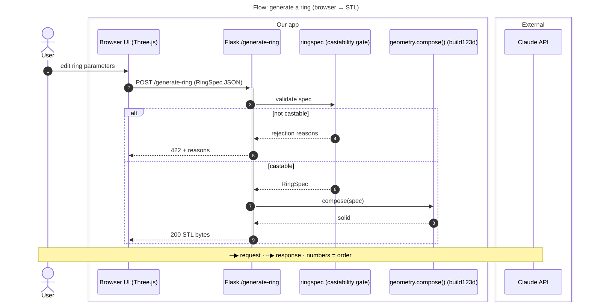

# diagram 🗺️

An Orbit bridge, like `start-ticket` and `ship`: it publishes something derived from the repo
rather than doing work on the spine. The diagrams are a **mirror of `HEAD`**, not a source of truth —
regenerated, never hand-maintained, so a stale set is fixed by running this again.

**One picture can't explain a codebase.** A dependency graph shows what the code *is*; it hides
the order things happen in and every response. So this draws a set, the way C4 and arc42 do:

- **The map** — one small `flowchart`: entry points, core, data, external services. Structure only.
- **The flows** — one `sequenceDiagram` per key request (C4's *dynamic diagram*, arc42's *runtime
  view*): request in, each step in order, every external hop, the response out, the failure branch.

Sources: [C4 dynamic diagrams](https://c4model.com/diagrams/dynamic),
[C4 notation](https://c4model.com/diagrams/notation), [arc42 §6](https://docs.arc42.org/section-6/).

The cost discipline is the point. The map is built by a pipeline, not by reading source into the
session. The flows need to know call order, which only code says — so they read **only the handlers
of the flows being drawn**, and nothing else.

## Steps

### 1. Read the frame
- `package.json` / `pyproject.toml` — what the project *is*, its entry scripts, its real
  dependencies (the import counts below include noise; the manifest says what's installed).
- The directory tree, not the file list: `git ls-tree -r -d --name-only HEAD | awk -F/ 'NF<=3'`.
- `CLAUDE.md` — the project's own vocabulary for its layers. Name nodes the way it does.

### 2. Count the links between modules
This greps import lines out of the committed tree, resolves each to a repo path or an external
package, groups paths by their first two directories (`src/` stripped — `app/api`, `server/db`,
`components`), and counts links between groups. It reads `HEAD`, so the result matches the commit
the diagrams are sent with. JS/TS (`import`, `export … from`, `require`, dynamic `import()`, `@/` and
`~/` aliases) and Python (absolute and relative).

```bash
{ git ls-tree -r -d --name-only HEAD | sed 's/^/D /'
  git grep -I -E -e "(from|import|require)[ (]*['\"]" -e '^[[:space:]]*(from|import)[[:space:]]+[.[:alnum:]_]' HEAD \
    -- '*.js' '*.jsx' '*.ts' '*.tsx' '*.mjs' '*.cjs' '*.vue' '*.svelte' '*.py' | sed 's/^HEAD://'
} | awk -v q="'" '
function norm(p,  n,a,o,i,k,r) { n = split(p, a, "/"); k = 0
  for (i = 1; i <= n; i++) { if (a[i] == "" || a[i] == ".") continue
    if (a[i] == "..") { if (k) k--; continue } o[++k] = a[i] }
  r = ""; for (i = 1; i <= k; i++) r = r (i > 1 ? "/" : "") o[i]; return r }
function grp(p,  n,a,s) { if (p in dir) p = p "/index"
  n = split(p, a, "/"); s = (a[1] == "src" && n > 2) ? 2 : 1
  if (n - 1 < s) return "(root)"; return (n - 1 > s) ? a[s] "/" a[s+1] : a[s] }
function base(p) { sub(/\/[^\/]*$/, "", p); return p }
function edge(t) { t = grp(t); if (t != from) print from " -> " t }
function ext(x) { print from " -> ext:" x }
/^D / { dir[substr($0, 3)] = 1; top[substr($0, 3)] = 1; next }
{ path = $0; sub(/:.*/, "", path); line = substr($0, length(path) + 2); from = grp(path) }
path ~ /\.py$/ {
  if (match(line, /^[ \t]*from[ \t]+[.A-Za-z0-9_]+/)) { m = substr(line, RSTART, RLENGTH); sub(/^[ \t]*from[ \t]+/, "", m); mods[1] = m; nm = 1 }
  else if (match(line, /^[ \t]*import[ \t]+[A-Za-z0-9_., \t]+/)) { m = substr(line, RSTART, RLENGTH); sub(/^[ \t]*import[ \t]+/, "", m); gsub(/[ \t]/, "", m); nm = split(m, mods, ",") }
  else next
  for (i = 1; i <= nm; i++) { m = mods[i]; d = match(m, /^\.+/) ? RLENGTH : 0; name = substr(m, d + 1); gsub(/\./, "/", name)
    if (d) { b = base(path); for (j = 1; j < d; j++) b = base(b); edge(norm(b "/" name)) }
    else { seg = name; sub(/\/.*/, "", seg)
      if (seg in top) edge(name); else if (("src/" seg) in top) edge("src/" name); else ext(seg) } }
  next }
{ re = "(from|import|require)[ (]*[\"" q "][^\"" q "]+[\"" q "]"
  while (match(line, re)) { spec = substr(line, RSTART, RLENGTH); line = substr(line, RSTART + RLENGTH)
    sub("^[^\"" q "]*[\"" q "]", "", spec); sub(".$", "", spec)
    if (spec ~ /^\./) edge(norm(base(path) "/" spec))
    else if (spec ~ /^[@~]\//) edge((("src") in dir ? "src/" : "") substr(spec, 3))
    else if (spec !~ /^node:/) { n = split(spec, a, "/"); ext(spec ~ /^@/ && n > 1 ? a[1] "/" a[2] : a[1]) } } }
' | sort | uniq -c | sort -rn
```

Output is one line per link, heaviest first: `14 app/api -> server/db`, `6 server/db -> ext:@prisma/client`.
It's a model of the imports, not the program — config-driven aliases other than `@/`/`~/`, framework
routing by convention, and stdlib imports (`ext:os`, `ext:fs`) all land slightly wrong. That's fine
at fifteen nodes; read it with the tree and the manifest, don't open files to fix it.

### 3. Draw the map — ≤ ~12 nodes
Smaller than it used to be: the flows carry the detail now, so the map only has to orient. A
`flowchart LR`, reading left to right, with one `subgraph` per layer — **named the way `CLAUDE.md`
names its layers**. Absent that, something like:
- **Entry** — routes, pages, CLI, workers, whatever the manifest and tree say receives traffic.
- **Core** — the domain / service layer the entry points call.
- **Data** — DB clients, schemas, caches.
- **External** — only what sits **across a process or network boundary**: things that can be down,
  slow, or billed (Stripe, a hosted database, an LLM API, S3). One node per service.

What goes where:
- **A library is not a service.** In-process libraries (Trimesh, build123d, Prisma's client) are
  drawn only when they're the system's engine, labelled `library`, inside the layer that uses them.
- **Vendored or bundled code isn't external.** `static/vendor/three` belongs to whatever ships it.
- **Drop the plumbing:** tests, UI-library internals (`components/ui`, `@radix-ui/*`, icon sets),
  stdlib, utility packages (`zod`, `clsx`, `lodash`). Merge groups that play the same role.

How it's drawn:
- **Arrows mean *depends on*, and say so** in a key node: `key["→ depends on · flows show the
  order and the replies"]`. The map makes no claim about order or responses — that's the flows' job.
- **No edge labels.** Naming the request belongs in the flows; on the map it invites readers to
  hunt for replies.
- **No counts on edges, ever.** Counts decide which edges to keep, then stay out of the picture.
- **Shapes mean something.** A cylinder `[( )]` is only for what stores data — database, cache,
  bucket. Services and libraries are rectangles.
- **Untangle crossings.** If two edges into the same target cross, drop the weaker one (lower
  count) or merge the sources.
- Safe ids with quoted labels: `api["app/api"]`.

### 4. Pick the flows — 2 to 4
List the entry points cheaply, without opening files:
```bash
git grep -n -E "@(app|bp|router|[a-z_]+)\.(route|get|post|put|patch|delete)\(|\b(app|router)\.(get|post|put|patch|delete)\(|export (async )?function (GET|POST|PUT|PATCH|DELETE)\b|@click\.command|add_parser\(" HEAD -- . ':!*test*'
```
Choose the flows a newcomer needs to understand the system — **architectural relevance, not
coverage** (arc42: "only a few"). Favour the one that does the product's main job, any that cross
an external service, and one with an interesting failure path. Name the ones you skipped in the
report. Never more than four; one is fine for a one-endpoint app.

### 5. Trace each flow — read only its handler
For each chosen flow, read **the handler function** (offset/limit to just its body, not the file),
then `git grep -n "def <name>\|function <name>"` for each own-module call it makes and read those
one level deep. Stop at a library or an external client — that's a participant, not something to
trace into. Budget: about a hundred lines read per flow. If a flow needs more to make sense, draw
what you've got and say what's uncertain.

### 6. Draw each flow
One `sequenceDiagram` per flow:


(The External box is here only to show the syntax — draw it only for flows that actually cross one.)

The rules:
- **Title states the scope:** `Flow: <what the user is doing> (<in> → <out>)`, in frontmatter.
- **`autonumber`, always.** Numbered steps are what make it a flow and not a picture of one.
- **Calls `->>`, responses `-->>`, and every call that returns gets its response drawn.** This is
  the whole point of the flow — a missing reply reads as fire-and-forget. Use `-)` only for
  genuinely async work (a queue, a background job).
- **Messages name the request and the payload:** `POST /generate-ring (RingSpec JSON)`,
  `200 STL bytes`, `compose(spec)`. Never `calls`, `uses`, `sends data`.
- **Participants are runtime things, labelled with their tech:** `Flask /generate-ring`,
  `Claude API`. ≤ ~7 per flow — merge the rest. Libraries appear only when they do the flow's
  real work.
- **`box Our app` / `box External`** separate what we run from what sits across a network boundary
  — same rule as the map's External layer. Omit `External` when the flow doesn't cross one.
- **One failure branch, in `alt … else … end`** — the one a newcomer would hit first (validation,
  an upstream error). Not every error path; that's code, not architecture.
- **≤ ~15 messages.** Past that, the flow is two flows or the steps are too fine — collapse a
  module's internals into one call.
- **End with the key as a `Note over`** spanning all participants: what solid, dashed and the
  numbers mean.

### 7. Read every render before showing it
Write each view to its own file in one temp dir, numbered in display order — map first:
`D=$(mktemp -d)`, then `$D/1-map.mmd`, `$D/2-generate-ring.mmd`, `$D/3-classify-ring.mmd`. The part
after the number is the view's id (kebab-case). Check each parses —
`for f in "$D"/*.mmd; do npx -y @mermaid-js/mermaid-cli -i "$f" -o "${f%.mmd}.svg" || echo "FAIL $f"; done`
if Node is around; otherwise re-read each for unbalanced blocks (`alt`/`box` without `end`) and
unquoted labels. Then ask of each: **what would a newcomer wrongly conclude from this?** A reply
that isn't drawn, a library in the External box, a map edge that reads as a request. Fix those
before step 9.

### 8. Find the project key
The same way `start-ticket` does: the repo's `CLAUDE.md`, or the prefix of `specs/<KEY>-*.md`. If
neither names one, `GET projects` lists them — ask which, don't guess. `ORBIT_URL` and
`ORBIT_API_TOKEN` must be set; if either isn't, stop and ask me to export them.

### 9. Show them, then push the set
Show each diagram's Mermaid and the commit they describe. If `git status --porcelain` is non-empty,
say so: the diagrams are of `HEAD`, not the working tree. **Confirm before the PUT** — it replaces
the project's whole set of views.

Send the files from step 7; Python builds the JSON (title from each file's frontmatter, id from its
filename, order from the number):
```bash
python3 - "$D"/*.mmd <<'PY' \
  | curl -s -w '\nHTTP %{http_code}\n' -X PUT --data-binary @- \
      -H "Authorization: Bearer $ORBIT_API_TOKEN" -H 'content-type: application/json' \
      "$ORBIT_URL/api/v1/projects/<KEY>/diagram"
import json, os, re, subprocess, sys
views = []
for p in sorted(sys.argv[1:], key=lambda p: int(os.path.basename(p).split("-", 1)[0])):
    src = open(p).read()
    title = re.search(r'^title:\s*"?(.*?)"?\s*$', src, re.M)
    views.append({"id": os.path.basename(p)[:-4].split("-", 1)[1],
                  "title": title.group(1) if title else os.path.basename(p)[:-4],
                  "mermaid": src})
print(json.dumps({"commit": subprocess.check_output(["git", "rev-parse", "HEAD"], text=True).strip(),
                  "views": views}))
PY
```
A `422` names the view Orbit rejected — fix that one and resend the set. Then
`GET projects/<KEY>/diagram` and check its `commit` is the one you sent and the view ids are in order.

### 10. Report
```
Diagrams: <KEY> @ <short-sha>   ·   map (<n> nodes) + <k> flows: <flow ids>
Skipped flows: <ids, or none>   ·   <one line on anything uncertain>
```

## Rules

- **A set, not a picture.** The map says what exists; the flows say what happens. Neither alone
  explains the codebase.
- **The map is never built from source.** The pipeline counts; you judge. If the counts look wrong,
  say so in the report rather than opening files to second-guess them.
- **Flows read handlers, nothing more.** Only the chosen flows' handlers and one level of own-module
  calls. Reading the rest of the codebase to make a flow "complete" is the cost this skill exists
  to avoid.
- **Every response is drawn.** In a flow, a call without its reply is a lie about the system.
- **Every visual element means one thing.** Map arrows mean *depends on*; solid flow arrows are
  requests, dashed are responses; cylinders store data; `External` means across a network boundary.
  Anything drawn for looks misleads.
- **Confirm before the PUT.** It's outward-facing and it replaces every view.
- **The diagrams are a mirror.** Nothing in the repo depends on them, so they never need a hand
  edit — rerun instead.
